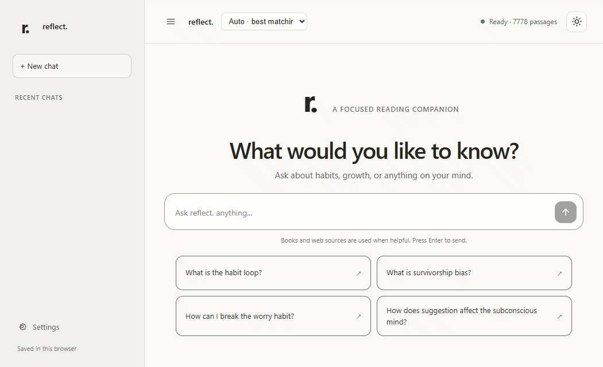
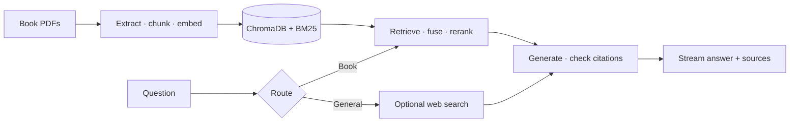

# reflect.

**A reading companion that answers naturally and shows its sources.**

reflect. searches ten locally indexed books for relevant passages, then presents a clear answer with links to the original PDF pages. For questions the books cannot answer, it can use public web results. The interface streams replies and keeps chat history in your browser.



*Illustrative UI demo with a scripted response. No model request is made during the recording.*

## What it does

- **Finds relevant passages:** Topic-aware PDF chunks are indexed with ChromaDB vectors and BM25 keywords, then reranked before generation.
- **Answers with context:** Groq, OpenRouter, and Vercel AI Gateway are tried in order when configured. Book citations link to highlighted source pages.
- **Handles broader questions:** An optional, keyless web search adds linked results when a book is not enough. If search is unavailable, the assistant can still give a qualified general answer.
- **Keeps local data local:** PDFs, indexes, `.env`, and browser chat history are excluded from Git. See [Privacy](#privacy) for what leaves the machine.

## Architecture



Ingestion runs locally and writes one vector collection, BM25 index, and chunk snapshot per book under `data/`. At query time, the router selects a relevant book in **Auto** mode. General questions can bypass book retrieval. [`docs/HOW_IT_WORKS.md`](docs/HOW_IT_WORKS.md) explains each stage.

## Quick start

You need Python 3.11 or newer, Windows PowerShell, a legally obtained copy of at least one supported PDF, and a key for at least one hosted model provider. The first run downloads the embedding and reranking models. See the [PDF filenames and book IDs](docs/SETUP.md#build-the-indexes) before ingesting.

```powershell
py -3 -m venv venv
.\venv\Scripts\python.exe -m pip install -r requirements.txt
Copy-Item .env.example .env
```

Add a provider key to `.env` (`GROQ_API_KEY`, `OPENROUTER_API_KEY`, or `VERCEL_API_KEY`). Keep the file private. Then index each PDF you have; Atomic Habits is the default book:

```powershell
.\venv\Scripts\python.exe main.py ingest
.\venv\Scripts\python.exe main.py ingest --book tiny_habits
.\venv\Scripts\python.exe main.py serve
```

Open [http://localhost:8000](http://localhost:8000). Leave the server terminal running. The **Auto** option searches the best matching indexed book; selecting a title focuses the search on that book. For more ingestion commands, model settings, and troubleshooting, use the [setup guide](docs/SETUP.md).

You can also ask from the command line:

```powershell
.\venv\Scripts\python.exe main.py query --book tiny_habits "What is an anchor moment?"
```

## Privacy

- PDFs, generated indexes, model files, `.env`, and local browser chat history are not committed to this repository.
- Hosted model providers receive the question and any retrieved book passages used to generate an answer. Provider keys are read from the local `.env` file.
- When web search is enabled, the search query is sent to a public search service. Set `WEB_SEARCH_ENABLED=false` in `.env` to turn it off. No separate search API key is needed.

## Development

```powershell
.\venv\Scripts\python.exe -m pytest tests -q
$jsTests = (Get-ChildItem .\tests -Filter '*.js').FullName
node --test $jsTests
```

To regenerate the illustrative GIF, install `playwright` and `pillow` in the virtual environment, start the app, and run `scripts/capture_demo.py`. The script uses installed Chrome and intercepts the example query locally.

See [setup and troubleshooting](docs/SETUP.md) and the [technical walkthrough](docs/HOW_IT_WORKS.md) for more detail.
