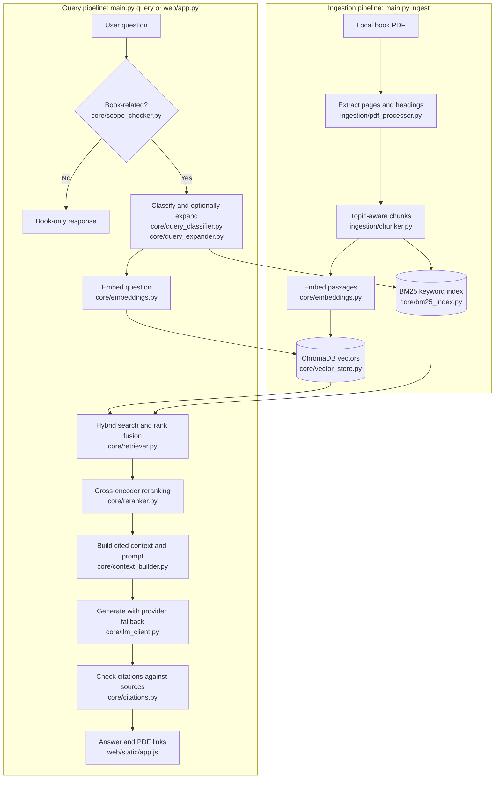

# habitRAG

reflect. answers questions naturally, using ten indexed books when their passages help. Questions beyond the books can use brief public web results, with linked sources when available. The local PDF system uses topic-aware chunks, hybrid search, reranking, streamed answers, and clickable source pages.

## Features

- Extracts text and headings from the PDF, then splits long topics into smaller chunks that keep the same topic label.
- Searches both ChromaDB embeddings and a BM25 keyword index, then combines their results and reranks the best passages.
- Answers with Groq, then tries OpenRouter and Vercel AI Gateway if earlier providers fail.
- Rejects clearly unrelated questions before searching the indexes.
- Shows cited PDF pages beside the chat. Conversation history and display preferences stay in the browser's local storage.

## Architecture



`ingestion/pipeline.py` coordinates the ingestion steps. `core/query_engine.py` coordinates question answering and streaming. ChromaDB, BM25, and a readable chunk snapshot are generated under `data/`.

## Get started on Windows

You need Python 3.11 or newer, Node.js for JavaScript tests, internet access for the first model downloads, and legally obtained copies of the books you want to search. Place the Atomic Habits PDF in this folder as `Atomic Habits by James Clear.pdf.pdf`, the Tiny Habits PDF as `tiny-habits.pdf`, the 386-page Power of Habit PDF as `Charles-Duhigg.The-Power-of-Habit.pdf`, the 220-page Power of Now PDF as `The Power of Now.pdf`, the 229-page Stoicism PDF as `[Jonas_Salzgeber]_The_Little_Book_of_Stoicism__Tim(z-lib.org).pdf`, the 252-page Mel Robbins PDF as `[Mel_Robbins]_The_5_Second_Rule__Transform_your_Li(z-lib.org).pdf`, the 312-page Goleman PDF as `Emotional Intelligence Why it Can Matter More Than IQ by Daniel Goleman.pdf`, the 225-page Dobelli PDF as `Rolf Dobelli - The Art of Thinking Clearly _ Better thinking, Better decision-Sceptre (Hodder _ Stoughton Ltd) (2013).pdf`, the 128-page Peale PDF as `The Power of Positive Thinking .pdf`, and the 171-page Murphy PDF as `The Power of Your Subconscious Mind.pdf`. The PDFs are excluded from GitHub.

In PowerShell, from the project folder:

```powershell
py -3 -m venv venv
.\venv\Scripts\python.exe -m pip install -r requirements.txt
Copy-Item .env.example .env
```

Open `.env` and add at least one provider key. Keep that file private. Blank entries are skipped.

```text
GROQ_API_KEY=
OPENROUTER_API_KEY=
VERCEL_API_KEY=
```

Build the search indexes, then start the web app:

```powershell
.\venv\Scripts\python.exe main.py ingest
.\venv\Scripts\python.exe main.py ingest --book tiny_habits
.\venv\Scripts\python.exe main.py ingest --book power_of_habit
.\venv\Scripts\python.exe main.py ingest --book power_of_now
.\venv\Scripts\python.exe main.py ingest --book little_book_of_stoicism
.\venv\Scripts\python.exe main.py ingest --book five_second_rule
.\venv\Scripts\python.exe main.py ingest --book emotional_intelligence
.\venv\Scripts\python.exe main.py ingest --book art_of_thinking_clearly
.\venv\Scripts\python.exe main.py ingest --book positive_thinking
.\venv\Scripts\python.exe main.py ingest --book subconscious_mind
.\venv\Scripts\python.exe main.py serve
```

Visit [http://localhost:8000](http://localhost:8000) and choose the PDF above the chat. Keep the server terminal open. For a command-line question, run `.\venv\Scripts\python.exe main.py query "What is habit stacking?"` or `.\venv\Scripts\python.exe main.py query --book five_second_rule "Why does counting backward help?"`. After changing a PDF or chunk settings, rebuild only that book with `main.py ingest --force --book five_second_rule` (or use another book name). Each book has its own vector collection, BM25 index, and chunk snapshot under `data/`.

## Run checks

```powershell
.\venv\Scripts\python.exe -m pytest tests -q
.\venv\Scripts\python.exe -m pip install ruff
.\venv\Scripts\ruff.exe check core ingestion web tests main.py config.py
$jsTests = (Get-ChildItem .\tests -Filter '*.js').FullName
node --test $jsTests
```

## Privacy and project data

`.env`, the book PDF, virtual environments, model downloads, generated indexes, browser chat history, and local planning files are excluded from Git. `.env.example` contains only empty key fields. Anyone cloning this public repository must supply their own PDF and API key.

See [setup and troubleshooting](docs/SETUP.md) for provider details and [how it works](docs/HOW_IT_WORKS.md) for a longer walkthrough.
